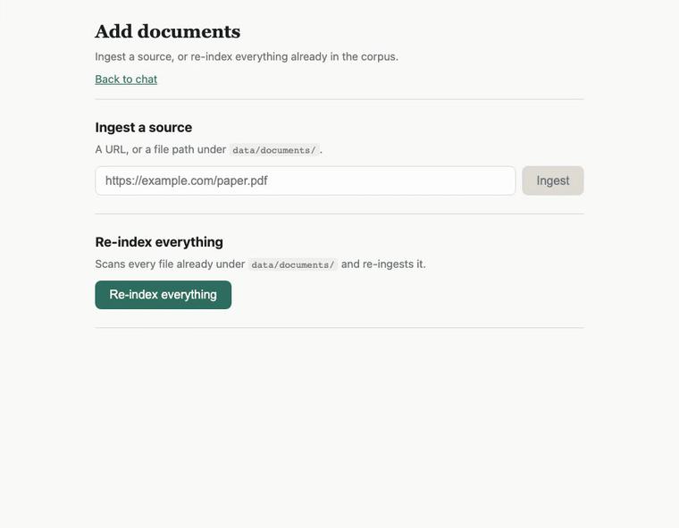

# AskTheDocs

A local-first RAG (Retrieval-Augmented Generation) system. Point it at
PDFs, Word docs, markdown/text files, or URLs — any documents, not just
research papers — then ask questions grounded in that content with cited
sources. No data leaves your machine except the LLM calls you explicitly
configure.



**Key features**

- **Local generation by default** — Ollama runs the language model; no
  API key required for the core pipeline.
- **Hybrid retrieval** — vector similarity blended with BM25 keyword
  search, with optional LLM query rewriting and cross-encoder reranking.
- **Grounded generation** — a deterministic citation guardrail refuses to
  answer unless the model actually cites retrieved content; cached
  answers (Valkey) avoid repeating the same retrieval/generation work.
- **Pluggable everywhere** — swap the generator, the judge, and the
  embeddings backend independently via config, without touching code.
- **Configurable LLM-as-judge evaluation** — score answer quality on
  accuracy, relevance, and completeness using a separately-configured
  model (e.g. Claude), with comparison toggles for the retrieval strategy.
- **Three interfaces, same logic** — a one-shot CLI, a long-running HTTP
  API, and a chat UI, all calling identical underlying code.
- **Graph RAG** — LLM-based triplet extraction, embedding-similarity
  entity resolution, and Neo4j GDS community detection power a local
  (entity-traversal) and global (corpus-theme) search path alongside
  hybrid retrieval, off by default.
- **Containerized** — `podman compose` (or `docker compose`) runs the
  whole stack (Ollama, Valkey, the app, the chat UI); nothing to install
  beyond that.
- **Security-hardened ingestion** — path-traversal and SSRF guards on
  every local file and URL before anything is read.

> See `docs/ARCHITECTURE.md` and `docs/CONCEPTS.md` for how retrieval,
> reranking, and Graph RAG fit together.

## Quickstart

```bash
git clone <this-repo> && cd ask-the-docs
cp .env.example .env.local        # reference copy -> your local config
podman compose up -d ollama-init  # starts Ollama, pulls the models (first run only)
podman compose up -d --build app  # builds if missing, rebuilds if stale, then starts it
podman image prune -f             # optional: reclaim the builder stage's disk space
```

The first start auto-ingests a curated set of LLM/RAG papers
(`seed_sources.yaml`), so there's already content to query:

```bash
curl -X POST localhost:8000/v1/ask -H "Content-Type: application/json" \
  -d '{"query": "What is Tree of Thoughts?"}'
```

That's the minimum path to a working answer. For every command, the HTTP
API equivalent, evaluation, bulk re-indexing, and troubleshooting, see
**[USAGE.md](USAGE.md)**.

## Development

```bash
uv sync          # installs locked dependencies for tests/tooling
uv run pytest    # runs the full test suite (no containers or API keys needed)
```

See **[CLAUDE.md](CLAUDE.md)** for architecture and contribution
conventions.

## Layout

- `src/ask_the_docs/` — package: `config`, `llm`, `embeddings`,
  `ingest`, `index`, `retrieve`, `answer`, `evaluate`, `cli`, `api`
- `data/documents/` — input documents (git-ignored)
- `data/index/` — persisted vector store (git-ignored)
- `evals/` — golden question set for evaluation
- `tests/` — unit tests
