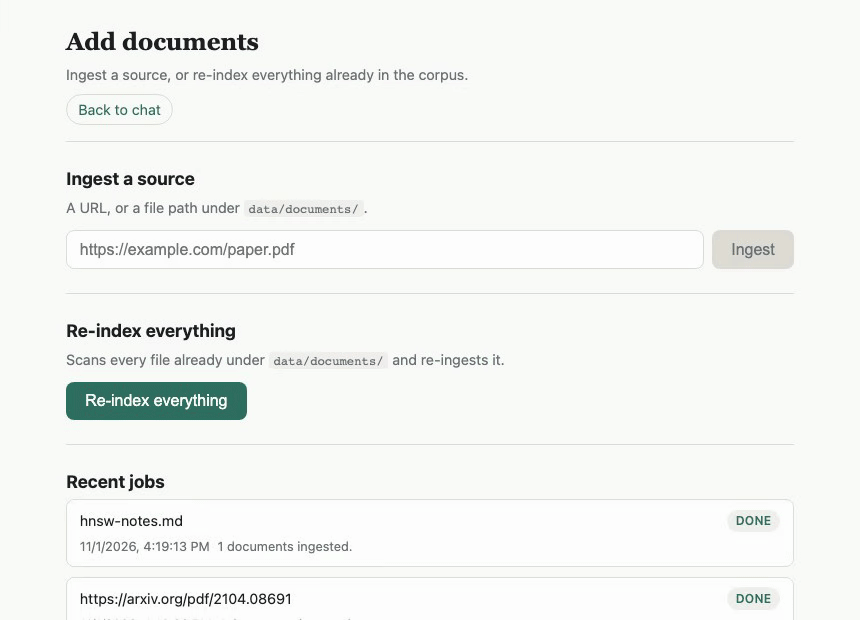

# AskTheDocs

A local-first RAG (Retrieval-Augmented Generation) system. Point it at
PDFs, Word docs, markdown/text files, or URLs (any documents, not only
research papers), then ask questions grounded in that content with cited
sources. Everything runs on your machine by default. Data leaves it only
if you configure a hosted LLM provider (queries and retrieved text are sent
as is), ingest a URL, or set a telemetry endpoint.



**Key features**

- **Local generation by default:** Ollama runs the language model; no
  API key required for the core pipeline.
- **Hybrid retrieval:** vector similarity blended with BM25 keyword
  search, with optional LLM query rewriting and cross-encoder reranking.
- **Grounded generation:** a deterministic citation guardrail refuses to
  answer unless the model cites retrieved chunks by number (it checks the
  markers exist, not that the chunk supports the claim); cached
  answers (Valkey) avoid repeating the same retrieval/generation work.
- **Pluggable everywhere:** swap the generator, the judge, and the
  embeddings backend independently via config, without touching code.
- **Configurable LLM-as-judge evaluation:** score answer quality on
  accuracy, relevance, and completeness using a separately-configured
  model (e.g. Claude), with comparison toggles for the retrieval strategy.
- **Three interfaces, same logic:** a one-shot CLI, a long-running HTTP
  API, and a chat UI, all calling identical underlying code.
- **Graph RAG:** LLM-based triplet extraction, embedding-similarity
  entity resolution, and Neo4j GDS community detection power a local
  (entity-traversal) and global (corpus-theme) search path alongside
  hybrid retrieval, off by default.
- **Containerized:** `podman compose` (or `docker compose`) runs the
  whole stack (Ollama, Valkey, the app, the chat UI); nothing to install
  beyond that.
- **Ingestion checks:** local paths are checked for traversal, file type,
  and size; URLs are checked against private, loopback, and internal
  addresses on every redirect. There is no malware scanning or sandboxed
  parsing.

## Architecture

[Interactive runtime architecture diagram](https://iamashraf.github.io/ask-the-docs/runtime-architecture.html). It shows components, trust boundaries, and the primary request path, and you can explore it in a browser.

Ingestion and query paths sharing Chroma, Redis, and Neo4j. Solid
borders are on the critical path; dashed borders are optional, toggled
off by default (Graph RAG, Neo4j). The project was built one slice at a
time. See `dev-docs/ARCHITECTURE.md` for the detailed flow and current
implementation notes.

See `dev-docs/ARCHITECTURE.md` for the full query/ingest flow and the tech
stack's rationale, and `dev-docs/CONCEPTS.md` for the concepts (vector
search, BM25, reranking, Graph RAG, ...) behind each stage.

## Quickstart

`app`, `worker`, and `web` join an external `llm-observability` Docker/Podman
network, and Compose refuses to start them without it. Create it once with
`podman network create llm-observability`. To also collect traces/metrics/
logs, start the sibling `llm-observability` repo's stack first (see its
README's "Start" section); without it, the app runs normally and the OTLP
exporters just retry/warn.

```bash
git clone <this-repo> && cd ask-the-docs
cp .env.example .env.local        # reference copy -> your local config
podman compose up -d ollama-init  # starts Ollama, pulls the models (first run only)
podman compose up -d --build app  # builds if missing, rebuilds if stale, then starts it
```

The first start auto-ingests a curated set of LLM/RAG papers
(`seed_sources.yaml`), so there's already content to query:

```bash
curl -X POST localhost:8000/v1/ask -H "Content-Type: application/json" \
  -d '{"query": "What is Tree of Thoughts?"}'
```

The services listen on `127.0.0.1` only, and the API has no authentication.

This is the minimum path to a working answer. For every command, the HTTP
API equivalent, evaluation, bulk re-indexing, and troubleshooting, see
**[USAGE.md](USAGE.md)**.

## Development

```bash
uv sync          # installs locked dependencies for tests/tooling
uv run pytest    # runs the full test suite (no containers or API keys needed)
```

See **[dev-docs/ARCHITECTURE.md](dev-docs/ARCHITECTURE.md)** for
architecture and **[CLAUDE.md](CLAUDE.md)** for contribution conventions.

## Guardrails

The checks are layered, and the model is treated as untrusted: its output is
checked before you see it. **The API has no authentication, so run it on
localhost only.**

- **Input:** request size limits; path, file type, size, and URL checks
  (public addresses only) before anything is ingested.
- **Generation:** retrieved text is fenced in `<documents>` tags and the model
  is told it is data, not instructions.
- **Output:** citation markers must match retrieved chunks, with one retry,
  then a refusal.
- **Exposure:** loopback-only ports by default, and a required Neo4j password
  when Graph RAG is on.

Rate limits, PII handling, and output scans are not built yet. See
[dev-docs/GUARDRAILS.md](dev-docs/GUARDRAILS.md) for details, failure
behavior, and gaps, and [SECURITY.md](SECURITY.md) to report a problem.

## Layout

- `src/ask_the_docs/`: package: `config`, `llm`, `embeddings`,
  `ingest`, `index`, `retrieve`, `answer`, `evaluate`, `cli`, `api`
- `web/`: the Next.js chat UI
- `e2e/`: end-to-end tests against the running stack
- `dev-docs/`: architecture, concepts, model comparison, guardrails
- `data/documents/`: input documents (git-ignored)
- `data/index/`: persisted vector store (git-ignored)
- `evals/`: golden question set for evaluation
- `tests/`: unit tests

## Contributing and license

See [CONTRIBUTING.md](CONTRIBUTING.md). Released under the [MIT License](LICENSE).
