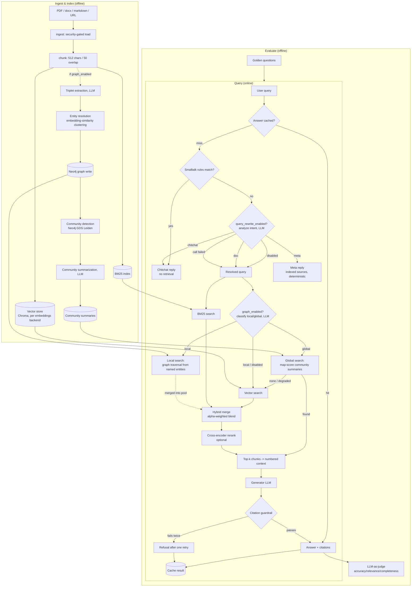

# Architecture

How a query moves through the system, and the concepts behind each stage.
For scope (what is built and what is not) see [CLAUDE.md](../CLAUDE.md). For
setup and usage see [USAGE.md](../USAGE.md).

## Diagram

The diagram shows the ingest and query *logic*, not process topology.
`/v1/ingest` and `/v1/index` validate the source synchronously, so a bad
request still gets an immediate 400 or 404. They then enqueue a job on NATS
JetStream and return `202`. The `dispatch`/`build_index` work in the Ingest
subgraph runs in a separate `worker` process, not the request handler.

For the full runtime topology (API, worker, NATS, Chroma, Valkey, Neo4j,
Ollama, and the trust boundary around them), see the interactive diagram:
[runtime-architecture.html](../docs/runtime-architecture.html). For the checks
the system runs and how each one fails, see [GUARDRAILS.md](GUARDRAILS.md).

## Graph RAG behavior

Graph RAG (triplet extraction, entity resolution, community
detection and summarization, local and global search) is gated behind
`graph_enabled` (default `False`). At query time, a Neo4j or LLM failure
degrades to the plain hybrid path above. So does a global search where no
community scores above 0 or every scoring call fails. At ingest time, the
build status (`ok`, `skipped` or `failed: <ExceptionClass>`) appears as
`graph` in the job result. A graph failure never fails the vector index job.

Graph indexing is incremental. `build_index` tells `build_graph` which
sources were new, replaced, or re-ingested with no chunks. The graph drops
those sources' facts: their `chunk_refs` on entities and `RELATED_TO` edges,
and any entity or edge left with none. It then extracts only the new chunks.
It resolves new entity names against the existing entity names, and existing
names win as canonical. Community detection and summaries then re-run over
the whole graph. An unchanged re-ingest does no extraction.

The graph is wiped and rebuilt from all chunks in three cases:

- The graph is empty.
- Old edges have no `chunk_refs`. The first ingest after upgrading re-tags
  them.
- The incremental update fails before it writes.

`ask-the-docs index --rebuild-graph` (or `build_index(...,
full_graph_rebuild=True)`) forces this rebuild. The API does not. Limits:

- Chunks whose extraction failed earlier are not retried on an unchanged re-ingest.
- Incremental and full rebuild can resolve entities slightly differently (first-seen cluster rule).
- Every changed ingest still embeds all existing entity names and re-runs Leiden over the whole graph.

Removing a source deletes its chunks, bumps the index generation once, and
drops its graph facts. A graph error does not fail the removal. Community
detection does not re-run. The file watcher sends a `remove` job for each
deleted file, so deploy the worker before the watcher. A full index also
prunes `docs_dir` sources whose files no longer exist. After a job that
changed the index, the worker pre-warms the BM25 cache and ignores any
pre-warm failure. This moves the BM25 rebuild off the first query, but the
rebuild still runs in full for each generation.

Two Valkey caches cut repeat LLM calls. Extracted triplets are cached per
chunk, keyed on chunk text, extraction prompt, and model, with a 30 day TTL.
Unparseable or failed extractions are not cached. Community summaries are
cached keyed on the sorted member names, prompt, and model. Leiden community
ids are unstable, so a summary is reused only when membership is identical. If
Valkey is down, extraction and summarization run as before.

## CLI and API

Both the CLI (`ingest`/`index`/`ask`/`evaluate`/`serve`/`worker`) and the
HTTP API (`/v1/...`) drive this same pipeline. No logic is duplicated between
them. There is one binary, not three. The `app` and `worker` containers in
`docker-compose.yml` are the same CLI image, started with `serve` and `worker`
respectively. `ingest`, `index`, `ask`, and `evaluate` are the CLI's own
direct, synchronous subcommands. They call the pipeline without going through
the API or the queue.

## Concepts used

- **Vector search.** Embeds chunks and the query into the same space and
  retrieves by similarity. It catches paraphrases and semantic matches.
- **BM25.** Classic sparse keyword scoring (the `bm25s` library, Lucene-style
  IDF). It catches exact terms and acronyms that vector search can miss.
- **Hybrid fusion.** Min-max normalization scales both sides' scores, then
  the pipeline blends them as `alpha * vector + (1 - alpha) * bm25`. A chunk
  found by only one side still competes, because the missing side scores 0.
  Nothing is dropped outright. Each side returns only its top
  `candidate_pool_size` hits, so min-max normalization sees only those, and
  any other chunk scores 0 on that side.
- **Intent routing.** A free rules check catches bare greetings, thanks, and
  goodbyes before anything else runs. Everything else goes through one LLM
  call that classifies the query as doc, chitchat, or meta. For doc, the call
  also rewrites the query into a standalone search query using conversation
  history. Routing decides what *kind* of input the query is, not whether the
  documents can answer it. An off-topic question is still routed as doc. The
  call returns four fields: intent, standalone query, search query, and reply.
  Only hybrid retrieval uses the search query. The generator gets the user's
  original wording next to the resolved question. If the source listing fails
  for a meta question, the reply falls back to the resolved queries.
- **Idempotent ingestion.** Each source gets a content hash over its page
  contents (length-separated), chunk size, chunk overlap, content format, and
  the embedding model. The pipeline skips an indexed source with the same
  hash. Changing any of those inputs re-embeds the source on the next index,
  so existing indexes re-embed once after an upgrade. A changed source is
  replaced by inserting the new chunks first, with deterministic ids
  `source_doc_id:hash:chunk_index`, then deleting only the stale old ids. A
  failed or repeated run neither loses nor duplicates data. A failure partway
  through a multi-batch insert can leave old and new chunks together until the
  next run cleans up.
- **Cross-encoder reranking.** A separate, more expensive model scores
  (query, chunk) pairs jointly and re-sorts the merged candidate pool before
  the pipeline truncates to the final k.
- **Citation-grounded generation.** The generator must cite `[n]` markers
  tied to the retrieved chunks. A deterministic guardrail (not an LLM)
  rejects missing or out-of-range citations, retries once, then refuses. It
  does not check that a cited chunk supports the claim. The prompt also fences
  the chunks in `<documents>` tags, escapes any such tag inside a chunk, and
  tells the model the content is data. That lowers the chance that the model
  follows a document's text as an instruction. It is not a guarantee.
- **LLM-as-judge evaluation.** A separately configured model scores answers
  against a golden question set, so you can compare retrieval and config
  changes on the same questions.
- **Pluggable backends.** Generator, judge, and embeddings are each a
  `Protocol` and factory pair (`llm.py`, `embeddings.py`). Swapping providers
  is a config change, not a code change.
- **Caching.** An exact-match answer cache (Valkey) has two tiers. Tier 1 (in
  `answer()`) is keyed on the query, the trimmed history, `history_max_turns`,
  the analyze prompt, and every setting that affects the answer. That includes
  the index generation, a counter bumped on every ingest write. Tier 2 (on the
  doc path) is keyed on the resolved standalone query, plus the user's raw
  wording when it differs. The generation is a local `.generation` file in the
  index directory, written atomically. It bumps after any change to the store
  (insert, replace, pure delete, or a failed run that already changed it) and
  not on an unchanged re-ingest. App and worker share it through the `./data`
  mount, so replicas must share that mount. A re-ingest invalidates stale
  entries automatically, even one that replaces a source with the same chunk
  count. The cache skips chitchat and meta answers, and any result built from
  a degraded retrieval (one side failed).
- **Graph RAG (local/global search).** At ingest time, an LLM extracts
  (subject, relation, object) triplets per chunk. The pipeline resolves them
  to canonical entities by embedding similarity and writes them to Neo4j.
  Neo4j GDS Leiden assigns communities, and an LLM summarizes each once. At
  query time, an LLM classifies the question as local (specific
  entities and relationships) or global (corpus-wide themes). Local queries
  traverse the graph from the named entities and merge matched chunks into the
  hybrid candidate pool before reranking. Global queries map-score every
  community summary against the question and return the top-N summaries
  directly, bypassing hybrid retrieval and rerank. It is off by default
  (`graph_enabled`). Every Neo4j or LLM call on this path degrades to the
  plain hybrid result rather than failing the request. Local search also
  returns the start entities' own chunks and orders entities by hop distance.
  Entity resolution compares each entity only against the first-seen entity of
  each cluster (no chaining). The pairwise comparison is O(n^2) in the worst
  case. The extraction, summary, and scoring prompts fence untrusted text and
  treat it as data.

## Tech stack & rationale

- **Chroma.** The vector store (`index.py`). It runs embedded in-process
  against a local persistence directory, so there is no database server to
  run or operate. This fits the project's local-first, small-footprint goal.
- **Valkey** (Redis-protocol). The cache (`cache.py`). It holds BM25 index
  rebuilds and exact-match answers, both keyed to invalidate automatically on
  re-ingest. In front of the Valkey-cached BM25 pickle, each process keeps the
  BM25 index (and the Chroma handle) in a size-1 cache keyed on (collection,
  index generation, index dir), behind a lock. A BM25 rebuild that fails on a
  Chroma read error is not cached. Valkey is an open-source,
  Linux-Foundation-backed fork. The project uses it instead of Redis to avoid
  Redis Inc.'s post-2024 source-available licensing.
- **NATS JetStream.** The ingest job queue (`queue.py`, `worker.py`).
  `/v1/ingest` and `/v1/index` publish a job and return `202` immediately, so
  a slow ingest (a large PDF, a remote URL) never ties up a request thread.
  The `worker` process consumes durably (at-least-once, redelivered on crash)
  and writes status to Valkey (`jobs.py`) for the `/v1/jobs/{id}` polling
  endpoint. JetStream state lives in the `nats_data` volume, so queued jobs
  survive container recreation. Compose sets `NATS_URL` for both `app` and
  `worker`. The worker runs ingestion off the event loop and heartbeats
  `in_progress` while a job runs, so a long job is not redelivered mid-run.
  Redelivery is capped (`max_deliver` 5), and the worker terminates an
  unparseable message. A finished job never goes back to `processing`.
- **Neo4j, with GDS.** The graph store for Graph RAG (`graph_store.py`,
  `community.py`), off by default. The `neo4j` compose service starts only
  with the `graph` profile. Leiden community detection runs *in the database*
  via the GDS library on the graph already stored there. This avoids pulling
  the whole graph into Python for a separate algorithm library.
- **FastAPI.** The HTTP API (`api.py`). Its Pydantic request and response
  models reuse the validation approach already used for `Settings`
  (`config.py`), so the project has one validation style.
- **Anthropic by default, pluggable.** The generator (`claude-haiku-5-5`)
  and the judge (`claude-sonnet-5-5`) use Anthropic through `llm.py`. The
  credential comes from config, then `ANTHROPIC_API_KEY`, then the
  `ant auth login` session. Ollama and OpenAI swap in through config alone
  (same `LLMClient` interface), without touching call sites. Embeddings
  (`embeddings.py`) run on Ollama or HuggingFace, because Anthropic has no
  embeddings API.
- **Podman or Docker compose.** One standard compose file defines the whole
  stack (Ollama, Valkey, NATS, the app, the worker, the web UI, and Neo4j
  under the `graph` profile). Every port is published on `127.0.0.1`.
  Podman's rootless, daemonless execution is the documented default, and
  Docker Compose works against the same file.
