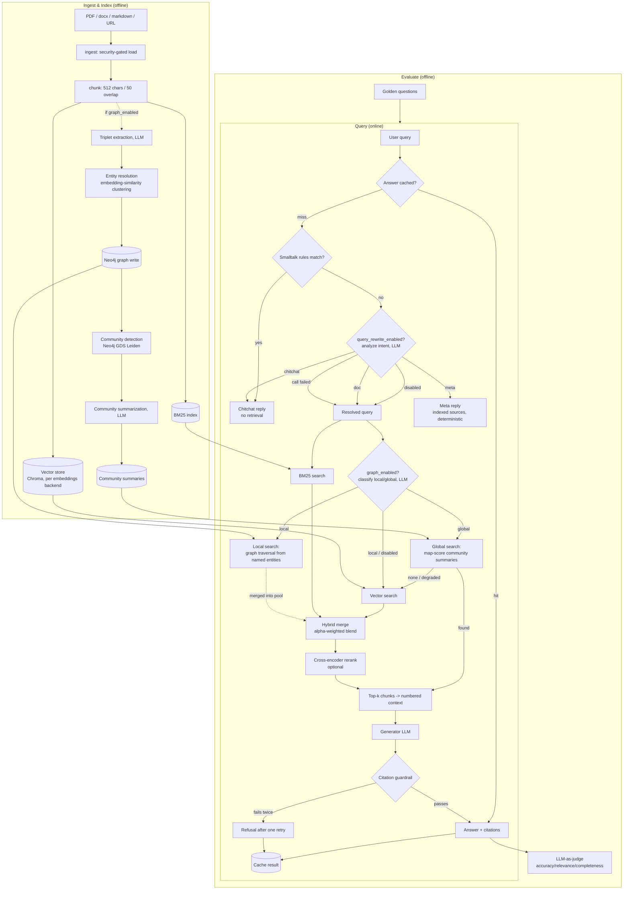

# Architecture

High-level view of how a query moves through the system, and the
concepts behind each stage. For scope (what's built vs. not yet) see
[CLAUDE.md](../CLAUDE.md); for setup/usage see [USAGE.md](../USAGE.md).

## Diagram

The diagram above shows the ingest/query *logic*, not process topology.
In practice, `/v1/ingest` and `/v1/index` validate the source
synchronously (so a bad request still gets an immediate 400/404), then
enqueue a job on NATS JetStream and return `202` — the actual
`dispatch`/`build_index` work in the Ingest subgraph above runs in a
separate `worker` process, not the request handler. For the full
runtime topology (API, worker, NATS, Chroma, Valkey, Neo4j, Ollama, and
the trust boundary around them), see the interactive diagram:
[runtime-architecture.html](../docs/runtime-architecture.html). For the checks the
system runs and how each one fails, see [GUARDRAILS.md](GUARDRAILS.md).

Graph RAG (triplet extraction, entity resolution, community
detection/summarization, local/global search) is entirely gated behind
`graph_enabled` (default `False`). At query time, a Neo4j/LLM failure
degrades to the plain hybrid path above, and so does a global search where
no community scores above 0 or every scoring call fails. At ingest time, the
build status (`ok`, `skipped` or `failed: <ExceptionClass>`) appears as
`graph` in the job result. A graph failure never fails the vector index
job.

Graph indexing is incremental. `build_index` tells `build_graph` which
sources were new, replaced or re-ingested with no chunks. The graph drops
those sources' facts (their `chunk_refs` on entities and `RELATED_TO`
edges, and any entity or edge left with none) and extracts only the new
chunks. New entity names are resolved against the existing entity names,
and existing names win as canonical. Community detection and summaries
then re-run over the whole graph. An unchanged re-ingest does no
extraction.

The graph is wiped and rebuilt from all chunks when it is empty, when old
edges have no `chunk_refs` (the first ingest after upgrading re-tags
them), or when the incremental update fails before it writes.
`build_index(..., full_graph_rebuild=True)` forces this rebuild, but
neither the CLI nor the API passes it. Limits:

- Chunks whose extraction failed earlier are not retried on an unchanged re-ingest.
- Incremental and full rebuild can resolve entities slightly differently (first-seen cluster rule).
- Every changed ingest still embeds all existing entity names and re-runs Leiden over the whole graph.

Both the CLI (`ingest`/`index`/`ask`/`evaluate`/`serve`/`worker`) and the
HTTP API (`/v1/...`) drive this same pipeline — no logic is duplicated
between them. There's one binary, not three: the `app` and `worker`
containers in `docker-compose.yml` are the same CLI image, started with
`serve`/`worker` respectively; `ingest`/`index`/`ask`/`evaluate` are the
CLI's own direct, synchronous subcommands that call the pipeline without
going through the API or the queue.

## Concepts used

- **Vector search** — embed chunks and the query into the same space;
  retrieve by similarity. Catches paraphrase/semantic matches.
- **BM25** — classic sparse keyword scoring (the `bm25s` library, Lucene-style IDF). Catches exact terms/acronyms
  vector search can miss.
- **Hybrid fusion** — both sides' scores are min-max normalized, then
  blended `alpha * vector + (1 - alpha) * bm25`; a chunk found by only one
  side still competes (missing side scores 0), nothing is dropped outright.
  Each side returns only its top `candidate_pool_size` hits, so min-max
  normalization sees only those, and any other chunk scores 0 on that side.
- **Intent routing**: a free rules check catches bare greetings, thanks,
  and goodbyes before anything else runs. Everything else goes through
  one LLM call that classifies the query doc, chitchat, or meta, and for
  doc rewrites it into a standalone search query using conversation
  history. This decides what *kind* of input the query is, not whether
  it's answerable: an off-topic question is still routed as doc.
  The call returns four fields (intent, standalone query, search query,
  reply). The search query is used only for hybrid retrieval. The
  generator gets the user's original wording next to the resolved
  question. A failed source listing for a meta question falls back to
  the resolved queries.
- **Idempotent ingestion** — each source gets a content hash over its
  page contents (length-separated), chunk size, chunk overlap, content
  format and the embedding model. An indexed source with the same hash is
  skipped. Changing any of those inputs re-embeds the source on the next
  index, so existing indexes re-embed once after an upgrade. A changed
  source is replaced by inserting the new chunks first, with
  deterministic ids `source_doc_id:hash:chunk_index`, then deleting only
  the stale old ids. A failed or repeated run neither loses nor
  duplicates data. A failure partway through a multi-batch insert can
  leave old and new chunks together until the next run cleans up.
- **Cross-encoder reranking** — a separate, more expensive model scores
  (query, chunk) pairs jointly to re-sort the merged candidate pool before
  truncating to the final k.
- **Citation-grounded generation** — the generator must cite `[n]`
  markers tied to the retrieved chunks; a deterministic guardrail (not an
  LLM) rejects missing or out-of-range citations, retries once, then refuses.
  It does not check that a cited chunk supports the claim. The prompt also
  fences the chunks in `<documents>` tags, escapes any such tag inside a
  chunk, and tells the model the content is data. That lowers the chance that
  a document's text is followed as an instruction. It is not a guarantee.
- **LLM-as-judge evaluation** — a separately-configured model scores
  answers against a golden question set, so retrieval/config changes can
  be compared objectively.
- **Pluggable backends** — generator, judge, and embeddings are each a
  `Protocol`/factory pair (`llm.py`, `embeddings.py`), so swapping
  providers is a config change, not a code change.
- **Caching** — exact-match answer cache (Valkey) with two tiers. Tier 1
  (in `answer()`) is keyed on the query, the trimmed history,
  `history_max_turns`, the analyze prompt and every setting that affects
  the answer, including the index generation, a counter bumped on every
  ingest write. Tier 2 (on the doc path) is keyed on the resolved
  standalone query, plus the user's raw wording when it differs. The
  generation is a local `.generation` file in the index directory,
  written atomically. It bumps after any change to the store (insert,
  replace, pure delete, or a failed run that already changed it) and not
  on an unchanged re-ingest. App and worker share it through the `./data`
  mount, so replicas must share that mount. A re-ingest invalidates stale
  entries automatically, even one that replaces a source with the same
  chunk count. Chitchat and meta
  answers are not cached, and neither is a result built from a degraded
  retrieval (one side failed).
- **Graph RAG (local/global search)** — at ingest time, an LLM extracts
  (subject, relation, object) triplets per chunk, resolved to canonical
  entities by embedding similarity and written to Neo4j; Neo4j GDS Leiden
  assigns communities, each summarized once by an LLM. At query time, an
  LLM classifies the question local (specific entities/relationships) or
  global (corpus-wide themes). Local queries traverse the graph from the
  named entities and merge matched chunks into the hybrid candidate pool
  before reranking; global queries map-score every community summary
  against the question and return the top-N summaries directly, bypassing
  hybrid/rerank. Off by default (`graph_enabled`); every Neo4j/LLM call on
  this path degrades to the plain hybrid result rather than failing the
  request. Local search also returns the start
  entities' own chunks and orders entities by hop distance. Entity
  resolution compares each entity only against the first-seen entity of
  each cluster (no chaining). The pairwise comparison is O(n^2) in the
  worst case. The extraction, summary and scoring prompts fence untrusted
  text and treat it as data.

## Tech stack & rationale

- **Chroma** — the vector store (`index.py`). Runs embedded in-process
  against a local persistence directory, so there's no separate database
  server to run or operate, matching this project's local-first,
  minimal-footprint posture.
- **Valkey** (Redis-protocol) — the cache (`cache.py`): BM25 index
  rebuilds and exact-match answers, both keyed to invalidate
  automatically on re-ingest. In front of the
  Valkey-cached BM25 pickle, each process keeps the BM25 index (and the
  Chroma handle) in a size-1 cache keyed on (collection, index generation,
  index dir), behind a lock. A BM25 rebuild that fails on a Chroma read
  error is not cached. An open-source, Linux-Foundation-backed
  fork rather than Redis itself, avoiding Redis Inc.'s post-2024
  source-available licensing.
- **NATS JetStream** — the ingest job queue (`queue.py`, `worker.py`):
  `/v1/ingest`/`/v1/index` publish a job and return `202` immediately,
  so a slow ingest (a large PDF, a remote URL) never ties up a request
  thread; the `worker` process consumes durably (at-least-once,
  redelivered on crash) and writes status to Valkey (`jobs.py`) for the
  `/v1/jobs/{id}` polling endpoint. JetStream state lives in the
  `nats_data` volume, so queued jobs survive container recreation.
  Compose sets `NATS_URL` for both `app` and `worker`. The
  worker runs ingestion off the event loop and heartbeats `in_progress`
  while a job runs, so a long job is not redelivered mid-run. Redelivery
  is capped (`max_deliver` 5), and an unparseable message is terminated.
  A finished job never goes back to `processing`.
- **Neo4j, with GDS** — the graph store for Graph RAG (`graph_store.py`,
  `community.py`), off by default. The `neo4j` compose service starts only
  with the `graph` profile. Leiden community detection runs
  *in the database* via the GDS library against the graph already
  stored there, instead of pulling the whole graph into Python for a
  separate algorithm library.
- **FastAPI** — the HTTP API (`api.py`). Pydantic request/response
  models give it the same validation idiom already used for `Settings`
  (`config.py`), rather than a second one.
- **Ollama, pluggable** — the default LLM/embeddings backend
  (`llm.py`, `embeddings.py`): runs locally, no API key needed for the
  core pipeline. Anthropic/OpenAI swap in via config alone (same
  `LLMClient`/`Embeddings` interface) — e.g. for the judge role in
  evaluation — without touching call sites.
- **Podman- or Docker-compose** — the whole stack (Ollama, Valkey, NATS,
  the app, the worker, the web UI, and Neo4j under the `graph` profile) is
  one standard compose file, with every port published on `127.0.0.1`;
  Podman's rootless, daemonless execution is the documented default,
  with Docker Compose working against the same file.