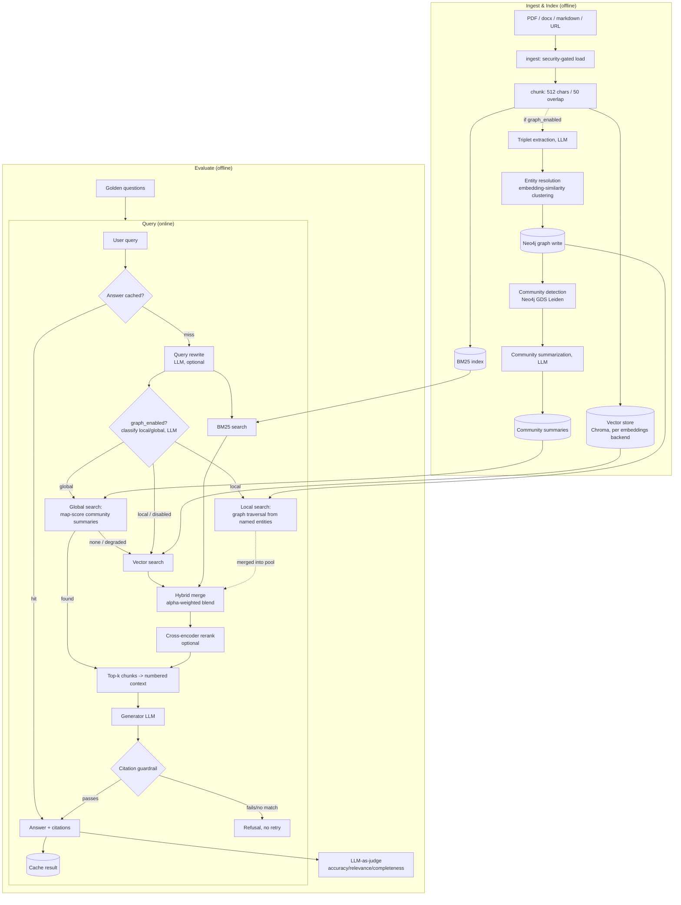

# Architecture

High-level view of how a query moves through the system, and the
concepts behind each stage. For scope (what's built vs. not yet) see
[CLAUDE.md](../CLAUDE.md); for setup/usage see [USAGE.md](../USAGE.md).

## Diagram

Graph RAG (triplet extraction, entity resolution, community
detection/summarization, local/global search) is entirely gated behind
`graph_enabled` (default `False`) and degrades to the plain hybrid path
above on any Neo4j/LLM failure — it never crashes an ingest or a query.

Both the CLI (`ingest`/`index`/`ask`/`evaluate`/`serve`) and the HTTP API
(`/v1/...`) drive this same pipeline — no logic is duplicated between them.

## Concepts used

- **Vector search** — embed chunks and the query into the same space;
  retrieve by similarity. Catches paraphrase/semantic matches.
- **BM25** — classic sparse keyword scoring. Catches exact terms/acronyms
  vector search can miss.
- **Hybrid fusion** — both sides' scores are min-max normalized, then
  blended `alpha * vector + (1 - alpha) * bm25`; a chunk found by only one
  side still competes (missing side scores 0), nothing is dropped outright.
- **Query rewriting** — an LLM call expands the user's question into a
  better search query (acronyms, synonyms) before retrieval, not before
  generation.
- **Cross-encoder reranking** — a separate, more expensive model scores
  (query, chunk) pairs jointly to re-sort the merged candidate pool before
  truncating to the final k.
- **Citation-grounded generation** — the generator must cite `[n]`
  markers tied to the retrieved chunks; a deterministic guardrail (not an
  LLM) rejects ungrounded or fabricated citations by refusing, not retrying.
- **LLM-as-judge evaluation** — a separately-configured model scores
  answers against a golden question set, so retrieval/config changes can
  be compared objectively.
- **Pluggable backends** — generator, judge, and embeddings are each a
  `Protocol`/factory pair (`llm.py`, `embeddings.py`), so swapping
  providers is a config change, not a code change.
- **Caching** — exact-match query cache (Valkey), keyed on the query plus
  every setting that affects the answer (including corpus chunk count),
  so a re-ingest invalidates stale entries automatically.
- **Graph RAG (local/global search)** — at ingest time, an LLM extracts
  (subject, relation, object) triplets per chunk, resolved to canonical
  entities by embedding similarity and written to Neo4j; Neo4j GDS Leiden
  assigns communities, each summarized once by an LLM. At query time, an
  LLM classifies the question local (specific entities/relationships) or
  global (corpus-wide themes). Local queries traverse the graph from the
  named entities and merge matched chunks into the hybrid candidate pool
  before reranking; global queries map-score every community summary
  against the question and return the top-N summaries directly, bypassing
  hybrid/rerank. Off by default (`graph_enabled`); every Neo4j/LLM call on
  this path degrades to the plain hybrid result rather than failing the
  request.